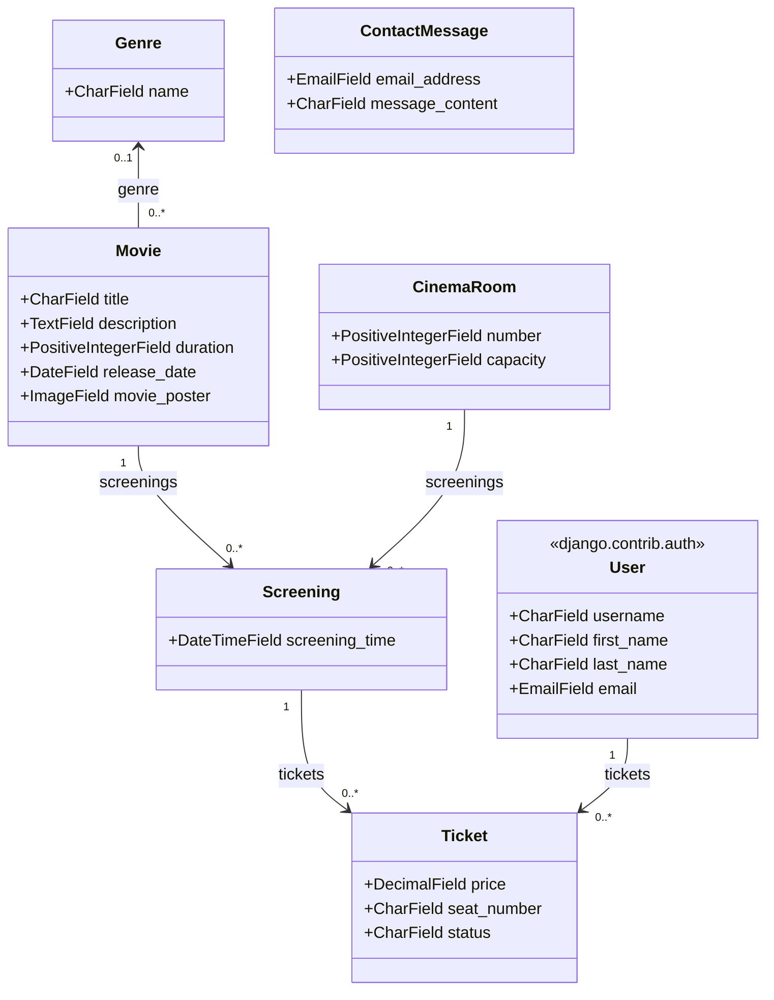

# django_cinema_project_2630720

Prototype d'application Django transactionnelle réalisé dans le cadre du cours *Programmation web et sécurité (420-E60-CH)*. Le site permet de consulter les films à l'affiche, de voir les séances à venir dans les différentes salles d'un cinéma et de réserver un billet. Une partie réservée au personnel permet de gérer le catalogue selon les permissions de chacun.

Le projet est découpé en deux applications :

- `cinema_app` : la partie publique (catalogue, réservations, compte client, contact) ;
- `employee_app` : l'espace employé (tableau de bord et gestion des films).

## Description

Le site s'articule autour de trois idées simples : un catalogue de films, un calendrier de séances liées à des salles et un système de réservation de billets nominatifs. Un visiteur peut parcourir les films, consulter les prochaines séances, puis réserver une place une fois connecté. Chaque billet est associé à une personne, à un siège précis et à un statut (réservé, payé ou annulé), ce qui permet de suivre le cycle de vie complet d'une réservation.

Lors d'une réservation, l'utilisateur choisit un film, une salle, une date, une heure et un siège. La projection correspondante est créée si elle n'existe pas encore, puis le billet y est rattaché. Un même siège ne peut pas être réservé deux fois pour la même projection.

Le personnel du cinéma dispose d'un espace dédié. L'accès est réservé aux membres des groupes `réceptionniste` et `administrateur`, et chaque action (consulter, ajouter, modifier, supprimer un film) est ensuite contrôlée par les permissions Django attribuées au groupe. Un employé ne voit que les actions qu'il a le droit d'effectuer, et les vues refusent toute action non autorisée, même si l'URL est saisie directement.

Le site est disponible en français (par défaut) et en anglais.

## Fonctionnalités

**Partie publique**

- Catalogue de films paginé, avec affiche, genre, durée et date de sortie
- Page de détail pour chaque film
- Prochaines séances affichées sur la page d'accueil
- Réservation de billets (film, salle, date, heure, siège), réservée aux utilisateurs connectés
- Validation des formulaires (date dans le passé refusée, siège déjà pris, champs obligatoires)
- Inscription, connexion et déconnexion
- Page « Mon compte » : modification du profil, liste de ses billets, annulation d'un billet pour une séance à venir
- Formulaire de contact accessible sans compte
- Messages de confirmation et d'erreur (`django.contrib.messages`)

**Espace employé**

- Tableau de bord affichant uniquement les rubriques accessibles selon les permissions
- Gestion complète des films (CRUD) avec les vues génériques `ListView`, `CreateView`, `UpdateView` et `DeleteView`
- Téléversement d'une affiche avec aperçu immédiat de l'image sélectionnée
- Saisie des titres et descriptions en français et en anglais
- Page de confirmation avant toute suppression

**Administration**

- Interface d'administration personnalisée (`list_display`, `list_filter`, `search_fields`, `date_hierarchy`)
- Aperçu des affiches dans la liste et la fiche des films
- Liens entre les genres et leurs films
- Champs traduits éditables dans les deux langues

**Internationalisation**

- Traduction du contenu de la base (titres, descriptions, genres) avec `django-modeltranslation`
- Traduction des textes des templates et des messages avec le système i18n de Django (`gettext`)
- Sélecteur de langue dans la barre de navigation

## Modèle de données

Un film appartient à un genre (facultatif), une projection associe un film à une salle et à un horaire, et un billet relie un utilisateur (modèle `User` de Django) à une projection pour un siège donné. Le modèle `ContactMessage` est indépendant et sert uniquement au formulaire de contact.



Les champs `Genre.name`, `Movie.title` et `Movie.description` sont traduits : `django-modeltranslation` ajoute en base les colonnes `_fr` et `_en` correspondantes.

## Structure du projet

```
django_cinema_project/
├── cinema_app/
│   ├── fixtures/
│   │   └── initial_data.json      # données de départ
│   ├── migrations/
│   ├── templates/
│   │   ├── cinema_app/            # pages publiques
│   │   └── registration/          # login.html, register.html
│   ├── admin.py
│   ├── constants.py
│   ├── context_processors.py
│   ├── forms.py
│   ├── models.py                  # Genre, Movie, CinemaRoom, Screening, Ticket, ContactMessage
│   ├── tests.py
│   ├── translation.py             # champs traduits (modeltranslation)
│   ├── urls.py
│   └── views.py
├── employee_app/
│   ├── templates/
│   │   ├── employee_app/          # dashboard.html
│   │   └── movie/                 # movies.html, movie_form.html, movie_delete.html
│   ├── forms.py                   # MovieForm
│   ├── mixins.py                  # contrôle d'accès employé et permissions
│   ├── tests.py
│   ├── urls.py
│   └── views.py
├── django_cinema_project_2630720/
│   ├── settings.py
│   ├── urls.py
│   ├── asgi.py
│   └── wsgi.py
├── locale/
│   └── en/LC_MESSAGES/            # django.po et django.mo
├── media/
│   └── movie_posters/             # affiches des films de départ
├── static/
│   ├── css/stylesheet.css
│   ├── js/poster_preview.js
│   └── img/
├── templates/
│   └── base.html
├── manage.py
├── requirements.txt
└── README.md
```

## Installation

```powershell
python -m venv .venv
.venv\Scripts\Activate.ps1
python -m pip install -r requirements.txt
python manage.py migrate
python manage.py loaddata initial_data
python manage.py runserver
```

Le site est ensuite accessible à l'adresse http://127.0.0.1:8000/.

Les fichiers de traduction compilés (`.mo`) sont fournis. S'ils devaient être régénérés, l'outil `gettext` doit être installé, puis :

```powershell
python manage.py compilemessages --ignore=.venv
```

## Données de départ

La commande `loaddata initial_data` charge un catalogue de films avec leurs genres et leurs affiches, les salles, des projections à venir, quelques billets, ainsi que les groupes d'employés et leurs permissions. Les affiches sont fournies dans le dossier `media/movie_posters/`.

Comptes de démonstration :

| Utilisateur      | Mot de passe        | Rôle                                               |
|------------------|---------------------|----------------------------------------------------|
| `2630720`        | `2630720`           | Superutilisateur, accès à l'administration         |
| `administrateur` | `Qwerty159!`        | Employé, accès à l'espace employé (plus de droits) |
| `receptionniste` | `Qwerty159!`        | Employé, accès à l'espace employé (restreint)      |
| `client`         | `Qwerty159!`        | Client ayant déjà des réservations                 |

## Tests

Les tests couvrent les règles métier (date de réservation, unicité des sièges), l'accès aux pages publiques, la protection des pages réservées aux utilisateurs connectés, ainsi que les droits d'accès à l'espace employé.

```powershell
python manage.py test
```

## Technologies

- Python 3.14 / Django 6.1
- Base de données SQLite
- django-modeltranslation pour la traduction du contenu
- Pillow pour la gestion des images
- Tailwind CSS (CDN) pour la mise en forme
- Font Awesome pour les icônes
- Système d'authentification et de permissions intégré de Django

## Auteur

Augustin Dellisse, projet réalisé individuellement dans le cadre du cours 420-E60-CH.