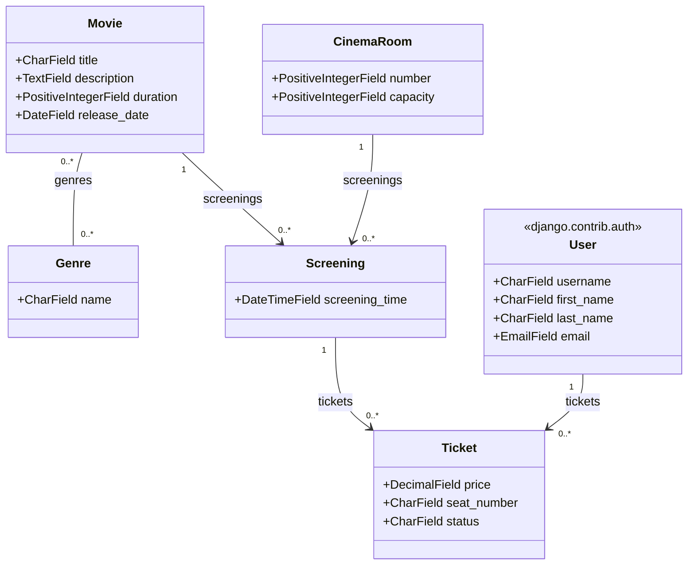

# django_cinema_project_2630720

Prototype d'application Django transactionnelle réalisé dans le cadre du cours *Programmation web et sécurité (420-E60-CH)*. L'application, contenue dans le module `cinema_app`, permet de consulter les films à l'affiche, de voir les séances à venir dans les différentes salles d'un cinéma, et de réserver un billet pour une séance.

## Description

Le site s'articule autour de trois idées simples : un catalogue de films, un calendrier de séances liées à des salles, et un système de réservation de billets nominatifs. Un visiteur peut parcourir les films et leurs genres, consulter les séances à venir triées par date, puis réserver une place pour la séance de son choix. Chaque billet est associé à une personne, à un siège précis et à un statut (réservé, payé ou annulé), ce qui permet de suivre le cycle de vie complet d'une réservation plutôt qu'une simple liste d'achats.

## Fonctionnalités

- Consultation du catalogue de films (titre, description, durée, date de sortie, genres)
- Consultation des séances à venir par film ou par salle
- Réservation de billets, avec sélection du siège et gestion des statuts
- Gestion des comptes utilisateurs (inscription, connexion, déconnexion)
- Restriction de certaines actions (réservation) aux utilisateurs connectés
- Interface d'administration personnalisée pour la gestion du catalogue et des séances

## Modèle de données

Le schéma ci-dessous illustre les modèles de l'application et leurs relations. Un film peut appartenir à plusieurs genres, une séance associe un film à une salle et à un horaire, et un billet relie un utilisateur (modèle `User` du système d'authentification de Django) à une séance précise pour un siège donné.



## Structure du projet

```
django_cinema_project_2630720/
├── cinema_app/
│   ├── models.py        # Genre, Movie, CinemaRoom, Screening, Ticket, User
│   ├── views.py
│   ├── forms.py
│   ├── urls.py
│   ├── admin.py
│   ├── templates/
│   │   └── cinema_app/
│   └── static/
│       └── cinema_app/
├── django_cinema_project_2630720/
│   ├── settings.py
│   ├── urls.py
│   └── ...
├── requirements.txt
└── manage.py
```

## Technologies

- Python / Django
- Base de données SQLite
- Tailwind CSS pour la mise en forme
- Système d'authentification intégré de Django (`django.contrib.auth`)

## Auteur

Projet réalisé individuellement dans le cadre du cours 420-E60-CH.
