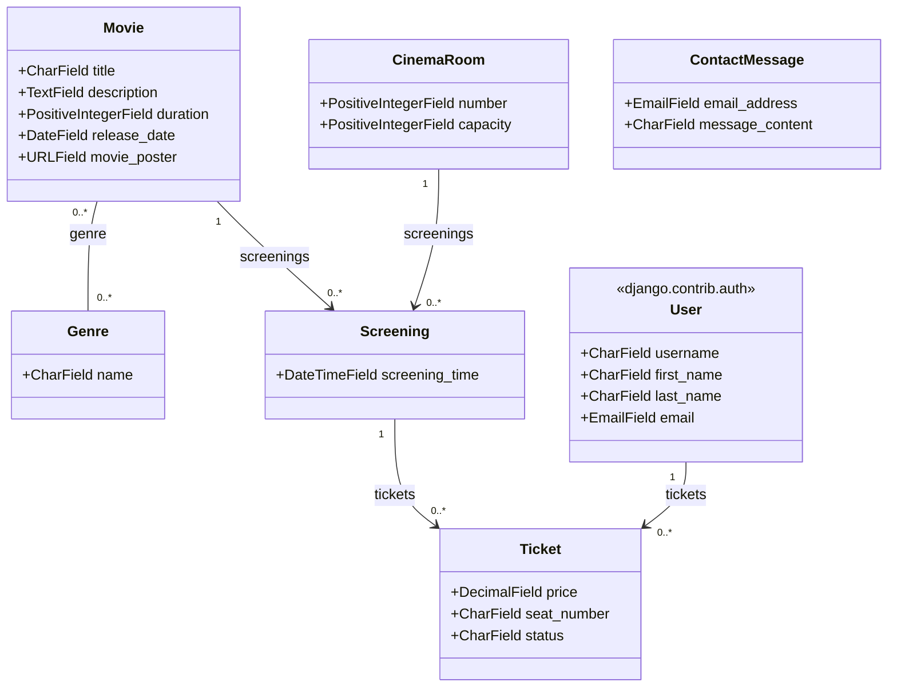

# django_cinema_project_2630720

Prototype d'application Django transactionnelle réalisé dans le cadre du cours *Programmation web et sécurité (420-E60-CH)*. L'application, contenue dans le module `cinema_app`, permet de consulter les films à l'affiche, de voir les séances à venir dans les différentes salles d'un cinéma, et de réserver un billet pour une séance.

## Description

Le site s'articule autour de trois idées simples : un catalogue de films, un calendrier de séances liées à des salles, et un système de réservation de billets nominatifs. Un visiteur peut parcourir les films et leurs genres, consulter les séances à venir, puis réserver une place pour la séance de son choix une fois connecté. Chaque billet est associé à une personne, à un siège précis et à un statut (réservé, payé ou annulé), ce qui permet de suivre le cycle de vie complet d'une réservation plutôt qu'une simple liste d'achats. Un formulaire de contact indépendant permet également à un visiteur d'envoyer un message, sans nécessiter de compte.

## Fonctionnalités

- Consultation du catalogue de films (titre, description, durée, date de sortie, genres), paginé
- Consultation d'un film en détail avec ses séances
- Réservation de billets, avec sélection du film, de la salle, de la date, de l'heure et du siège
- Gestion des statuts de billet (Réservé, Payé, Annulé) pour suivre le cycle de vie d'une réservation
- Formulaire de contact (indépendant de l'authentification)
- Gestion des comptes utilisateurs (inscription, connexion, déconnexion, modification du profil)
- Consultation et annulation de ses propres réservations depuis la page de compte
- Restriction de certaines actions (réservation, gestion du compte) aux utilisateurs connectés
- Messages de succès/erreur pour les actions de l'utilisateur (`django.contrib.messages`)
- Interface d'administration Django pour la gestion du catalogue et des séances

## Modèle de données

Le schéma ci-dessous illustre les modèles de l'application et leurs relations. Un film peut appartenir à plusieurs genres, une séance associe un film à une salle et à un horaire, et un billet relie un utilisateur (modèle `User` du système d'authentification de Django) à une séance précise pour un siège donné.



## Structure du projet

```
django_cinema_project/
├── cinema_app/
│ ├── migrations/
│ ├── templates/
│ │ └── cinema_app/
│ │ ├── account.html
│ │ ├── contact.html
│ │ ├── delete_ticket_confirm.html
│ │ ├── index.html
│ │ ├── movie.html
│ │ ├── movies.html
│ │ ├── reservation.html
│ │ └── registration/
│ │ ├── login.html
│ │ └── register.html
│ ├── admin.py
│ ├── apps.py
│ ├── constants.py
│ ├── forms.py
│ ├── models.py             # Genre, Movie, CinemaRoom, Screening, Ticket, ContactMessage
│ ├── tests.py
│ ├── urls.py
│ └── views.py
├── django_cinema_project_2630720/
│ ├── settings.py
│ ├── urls.py
│ ├── asgi.py
│ └── wsgi.py
├── static/
│ ├── css/
│ │ └── stylesheet.css
│ ├── js/
│ └── img/
├── templates/
│ └── base.html
├── db.sqlite3
├── manage.py
├── requirements.txt
└── README.md
```

## Technologies

- Python / Django
- Base de données SQLite
- Tailwind CSS (CDN) pour la mise en forme
- Font Awesome pour les icônes
- Système d'authentification intégré de Django (`django.contrib.auth`)

## Auteur

Projet réalisé individuellement dans le cadre du cours 420-E60-CH.
